<div align="center">



<br />

[;%3E+VFX+Rotoscope+Artist+on+The+Flash+%26+Black+Panther%3A+Wakanda+Forever;%3E+Eurekathon+3rd+Place+%E2%80%A2+Manthan+2026+Round+2+%E2%80%A2+NASA+Space+Apps+Nominee)](https://github.com/mohammed-Araf)

</div>

---

### `❯ cat ./whoami.yml`

```yaml
identity:
  name: "Mohammed Araf"
  role: "B.Tech CS&T Student · Full-Stack Dev · Hardware Innovator · VFX Artist"
  location: "Bangalore, India"
  education: "Dayananda Sagar University (2024–2027) · NPTEL Data Analytics with Python"

highlights:
  patent: "Universal Filter Interface (UFI) — Modular Air Purification (Published)"
  vfx_credits: ["The Flash", "Black Panther: Wakanda Forever"] # @ Radiance VFX (Mocha Pro)
  recognitions:
    - "3rd Place — Eurekathon (DSU) · CoFarm"
    - "Round 2 Qualifier — Manthan Innovation Challenge 2026"
    - "Global Nominee — NASA International Space Apps Challenge"
    - "Participant — IBM Hackathon"
```

---

### `❯ ls ./featured-projects`

<table>
  <tr>
    <td width="50%" valign="top">
      <h4><a href="https://github.com/mohammed-Araf/CoFarm">CoFarm</a> <code>TypeScript · Vue.js · Edge AI</code></h4>
      Privacy-first agritech platform enabling farmer threat-intelligence sharing via edge anomaly detection, decentralised consensus, and LLM-powered actionable insights.<br/>
      <sub>🏆 <b>3rd Place — Eurekathon (DSU)</b></sub>
    </td>
    <td width="50%" valign="top">
      <h4><a href="https://github.com/mohammed-Araf">Cashtip</a> <code>Vue.js · TypeScript · Webhooks</code></h4>
      Real-time streamer tip &amp; overlay platform with a StreamElements webhook + API pipeline triggering instant on-screen browser overlays upon payment verification.
    </td>
  </tr>
  <tr>
    <td width="50%" valign="top">
      <h4><a href="https://github.com/mohammed-Araf">Compact Air Purifier &amp; UFI</a> <code>Hardware · IoT · PLA</code></h4>
      Modular air purification system driven to Rs. 3,000–3,500 via Lean Startup loops: biodegradable PLA chassis, USB-C, &lt;40 dB airflow, and interchangeable UFI filter mount.<br/>
      <sub>📄 <b>Published Patent Application</b> · 🚀 <b>Manthan 2026 Round 2</b></sub>
    </td>
    <td width="50%" valign="top">
      <h4><a href="https://github.com/mohammed-Araf/Wallpaper">Wallpaper</a> <code>Kotlin · Android · Real-Time</code></h4>
      Live shared interactive canvas synced across two Android devices in real time.
    </td>
  </tr>
  <tr>
    <td width="50%" valign="top">
      <h4><a href="https://github.com/mohammed-Araf/TS-Music-Bot">TS Music Bot</a> <code>Python · Kotlin · GPL v3</code></h4>
      Feature-rich TeamSpeak music bot with queue management, playback controls, and audio streaming.
    </td>
    <td width="50%" valign="top">
      <h4><a href="https://github.com/mohammed-Araf/steam-lua-generator">Steam Lua Generator</a> <code>Python · Lua · Desktop</code></h4>
      Modern dark-UI desktop application for generating Lua scripts and DepotDownloader-compatible files.
    </td>
  </tr>
</table>

---

### `❯ ./stack --grouped`

<div align="center">

**Languages**
<br/>


**Web, Cloud & AI**
<br/>


**Hardware & VFX**
<br/>


</div>

---

### `❯ fetch --telemetry mohammed-Araf`

<div align="center">


<br/>


</div>

---

### `❯ open ./links`

<div align="center">

[](mailto:mdaraf26@gmail.com)
[](https://linkedin.com/in/mohammed-araf-140247167)
[](https://x.com/@Mohammed_Araf_)
[](https://discord.gg/BqWM4XnaUP)
[](https://youtube.com/@alancruse007)

<br/>


</div>
